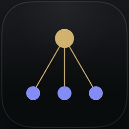

<p align="center"></p>

# tokenwise studio

**One agent orchestrates, the others do the work.** Let Claude Opus plan and review while ChatGPT Codex **Sol**, Claude **Haiku/Sonnet** or **Gemini** do the hands-on work, each in its own git worktree, with a live web UI to watch and approve it all.

Companion to [tokenwise](https://github.com/OnurSamett/tokenwise): tokenwise decides *which* model should do a piece of work; studio gives the orchestrator a way to actually hand it to another agent and merge the result.

```
           ┌──────────────────────────────┐
           │  Orchestrator (Claude Opus)   │  plans, reviews, merges
           └──────────────┬───────────────┘
                 delegate │ (MCP tools)
       ┌──────────────────┼──────────────────┐
       ▼                  ▼                  ▼
 Codex sol·medium   Claude haiku·low    Gemini (Flash/Pro)
 worktree tw/…a1    read-only answer    worktree tw/…c3
       └───── job_diff → job_merge / job_discard ─────┘
```

## What it looks like

- **One calm conversation.** You describe a task; the orchestrator explains its plan and hands pieces to workers.
- **A team card per step**: each worker with its agent, model, effort and live progress.
- **"N files ready for review"**: one click opens a review drawer with per-file diffs and checkboxes. Nothing lands until you press *Apply* (changes are staged, not committed).
- **Plan limits in the sidebar**: your Claude and ChatGPT Codex 5-hour and weekly usage, read from the CLIs' own output.
- The orchestrator cannot edit files itself; every change comes from a worker you can review.

## Why

- **Spread usage across plans you already pay for.** Heavy thinking stays on Opus; mechanical edits run on your ChatGPT (Codex) or Google plan.
- **Safe by default.** Writing workers only ever touch their own git worktree. Nothing reaches your working tree until the orchestrator (or you, in the UI) applies the diff.
- **Watch it live.** Every job streams into the UI: agent, model · effort, status, output, and the diff.

## Requirements

- Node 20+, git
- At least one worker CLI, signed in: [Codex CLI](https://github.com/openai/codex) (`codex login`), [Claude Code](https://www.npmjs.com/package/@anthropic-ai/claude-code) (`claude auth login`), Gemini via [Google Antigravity](https://antigravity.google) (`agy`, included in Gemini.app on macOS; run it once to sign in with your Google account; models `hydrogen` (fast, default) and `argon` (frontier)) or [Gemini CLI](https://github.com/google-gemini/gemini-cli) with `GEMINI_API_KEY` (Gemini CLI's own Google sign-in no longer works for individuals)

## Install

```bash
npm install -g github:OnurSamett/tokenwise-studio
tokenwise-studio setup
```

`setup` prints what it will change, then does two things:

- registers the MCP server with Claude Code at user scope (`claude mcp add tokenwise-studio --scope user`), if the `claude` CLI is installed and it isn't registered yet;
- on macOS, creates the app `~/Applications/tokenwise studio.app`: a normal Mac app with its own window and Dock icon (no browser tab). Opening it asks for a project folder; ⌘O opens another project (File > Open Recent lists earlier ones), each project gets its own window. Servers keep running when you quit the app, so they stay shared with terminal use.

It ends with a readiness check. Use `tokenwise-studio setup --dry-run` to see the plan without changing anything (`--no-mcp` and `--no-app` skip a part).

Then start it from your project:

```bash
cd your-project && tokenwise-studio     # options: --port N, --no-open, --browser, --pick
```

With the app installed, `tokenwise-studio` opens the project in the app window; pass `--browser` to use a browser tab instead (the default when the app isn't installed). `--no-open` just starts the server.

Other commands: `tokenwise-studio doctor` shows which workers are ready and how to fix the rest; `tokenwise-studio uninstall` removes the MCP registration and the launcher app (then run `npm uninstall -g tokenwise-studio`).

From a clone (development):

```bash
git clone https://github.com/OnurSamett/tokenwise-studio.git
cd tokenwise-studio && npm install
node src/cli.js /path/to/project
```

## Updating

```bash
tokenwise-studio update --check   # just report whether a newer version exists
tokenwise-studio update           # install it and rebuild the Mac app
```

`update` reinstalls the way you installed (npm or GitHub), then runs `tokenwise-studio setup` again so the Mac app matches the new version. Restart the app afterwards. Running from a git checkout? Use `git pull` instead. When a newer version exists, the sidebar shows a small "New version" note with the command to copy; nothing is ever installed from the browser. Release notes are in [CHANGELOG.md](CHANGELOG.md).

## Use

Just ask your orchestrator, e.g. in Claude Code on Opus:

> Fix the failing tests. Delegate each independent fix to codex sol at medium effort as a write job, review the diffs, merge the good ones, then run the tests.

### Notifications

On macOS, tokenwise studio shows a desktop notification when a direct worker finishes or fails (not those started by a studio chat), and when an orchestrator turn finishes, needs you, or moves from Claude to Codex. Jobs ready for review are called out. Toggle them with the bell button in the studio sidebar, or set `TOKENWISE_NOTIFY=0` to turn them off entirely. The setting is stored in `~/.tokenwise-studio/settings.json`.

After `tokenwise-studio setup`, notifications come from the tokenwise studio app in `~/Applications` (the first one asks for permission), and clicking one opens that project's studio. Without the Xcode command line tools (no Swift compiler) setup falls back to a plain launcher and notifications come via Script Editor.

### Team settings

Per project you choose how the orchestrator picks workers. **Auto** (default) lets it decide by its own guide. **Manual** fixes an agent, model and effort for each role (code, quick work, reviews, images); start from a preset (quality, balanced or cheap) and adjust. The choice is stored in `.tokenwise-studio/team.json`. The orchestrator follows it and only deviates when a plan is out of quota. You can also forbid the free workers or allow Codex astra there.

### Models

| Agent | fast | balanced | frontier |
|---|---|---|---|
| Codex | Codex Luna | Codex Terra, Codex Sol | Codex Astra |
| Claude | Claude Haiku | Claude Sonnet | Claude Opus |
| Gemini (Antigravity) | Gemini Flash | Gemini Hydrogen | Gemini Argon |
| Free (NVIDIA) | Laguna XS 2.1, Nemotron 3.5 Lightning | DeepSeek V4.1 Flash, GLM 5.3 Flash, MiniMax M3.1 Flash, GPT-OSS | Kimi K3.1 Pro, Mistral Large 4, Nemotron 3 Ultra, Step 5 Preview |

Free NVIDIA models can be picked individually in the Team panel.

### MCP tools

| Tool | What it does |
|------|--------------|
| `delegate` | Start a job: `agent` (codex/claude/gemini), `model`, `effort`, `task`, `write` |
| `job_wait` | Wait for a job and get its answer + diff summary |
| `job_status` | List jobs or inspect one |
| `job_diff` | Full diff of a write job |
| `job_merge` | Apply a job's diff to your working tree (staged, not committed) and clean up |
| `job_discard` | Stop and throw away a job |

### When a plan runs out

Jobs fall back automatically along `codex → gemini → claude → free → local` (override with `TOKENWISE_FALLBACK`):

- **Before starting**, a job skips any plan at or above `TOKENWISE_LIMIT_THRESHOLD` (default 90%) of its 5-hour or weekly limit, or a worker that isn't signed in.
- **While running**, a job that fails with a rate/usage-limit error is re-run on the next worker; the UI shows "↪ took over from Codex · hit a rate limit", and `job_wait` follows the move.
- **The orchestrator itself** moves from Claude to Codex (read-only, same delegation tools) when Claude is near its limit or hits it mid-turn; the UI shows "↪ Codex Sol took over". Gemini cannot orchestrate because Antigravity has no per-session MCP. Disable with `TOKENWISE_ORCH_FALLBACK=0`.
- **local**: an Ollama model driven by Codex CLI's `--oss` mode: free, unlimited, full agent (`brew install ollama && ollama pull gpt-oss:20b`).
- **free**: free-tier hosted APIs, tried in order: NVIDIA (`NVIDIA_API_KEY` from build.nvidia.com), OpenRouter `:free`, Groq, Mistral, or any OpenAI-compatible endpoint (`TOKENWISE_FREE_BASE` + `TOKENWISE_FREE_KEY`). A rate limit on one moves to the next. Free models run inside studio's own small tool loop (`src/freeagent.js`), so they read the repo and, in write jobs, edit files in their worktree; they cannot run commands, and paths are confined to the worktree with symlinks, `.git` and secret files blocked. Used only after you opt in with `TOKENWISE_ALLOW_FREE=1`, since free tiers may use prompts for training.

### Defaults and guard rails

- Codex: `sol` at `medium` (families `terra`/`sol` resolve to the newest version automatically). `astra` is blocked unless `TOKENWISE_CODEX_ASTRA=1`.
- Claude: `haiku` at `low`. Gemini (Antigravity): `hydrogen` at `medium`; write jobs may run commands only inside Antigravity's terminal sandbox.
- `max`/`ultra` effort is refused.
- Write jobs branch from `HEAD`: uncommitted changes in your tree aren't visible to workers.
- The UI binds to `127.0.0.1` only. State lives in `.tokenwise-studio/` (git-excluded automatically).

## Status

Early (v0.3). Codex and Claude workers are tested end to end; Gemini is wired up but less tested. Issues and PRs welcome.

## License

MIT

---

Provider and model logos (in `assets/providers/`, from the MIT-licensed [lobe-icons](https://github.com/lobehub/lobe-icons), unmodified) are trademarks of their respective owners and are used only to identify each provider or model. tokenwise studio is not affiliated with, endorsed by, or sponsored by OpenAI, Anthropic, Google, NVIDIA or any other provider shown.
