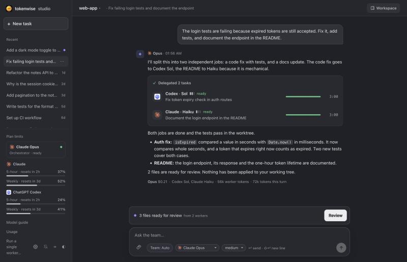
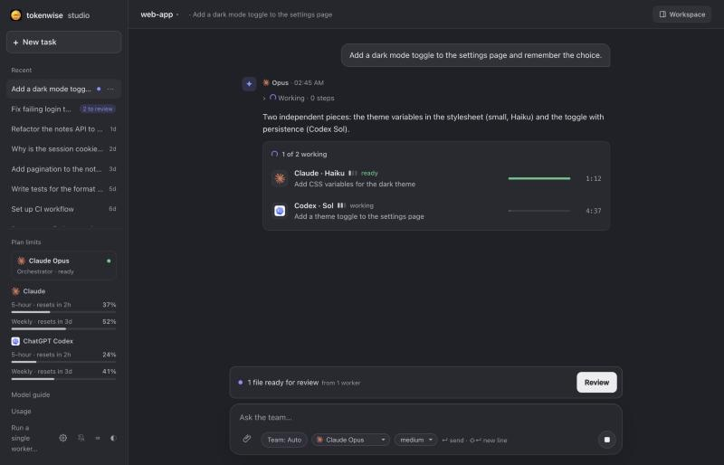
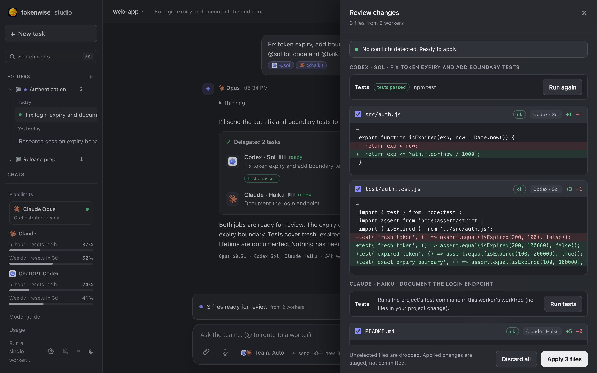
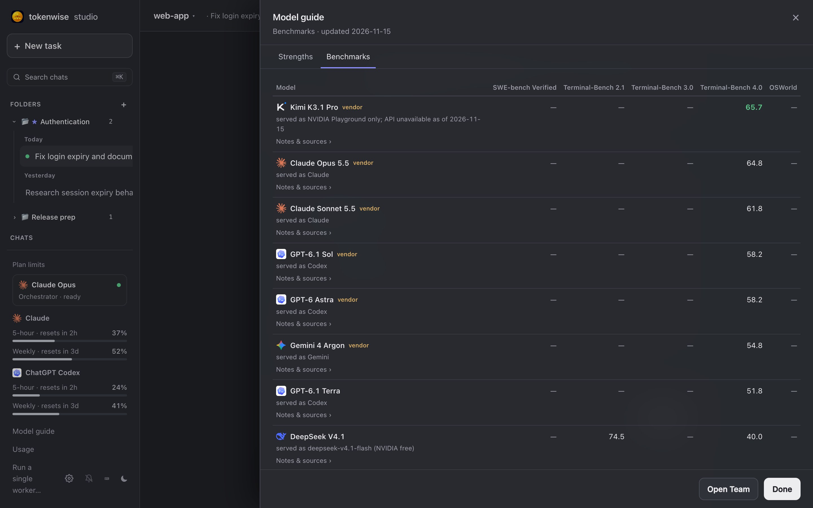
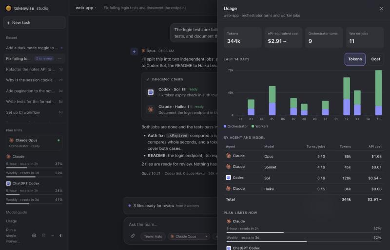
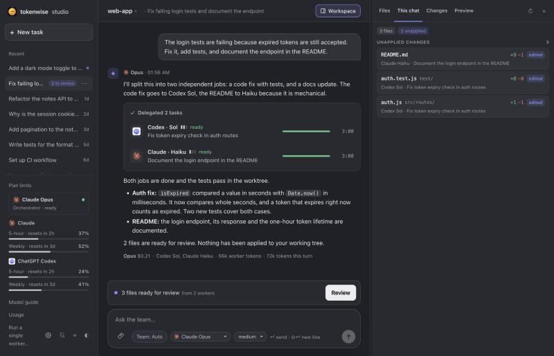
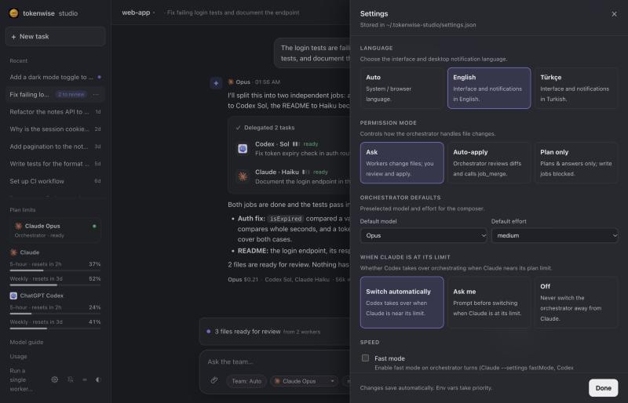
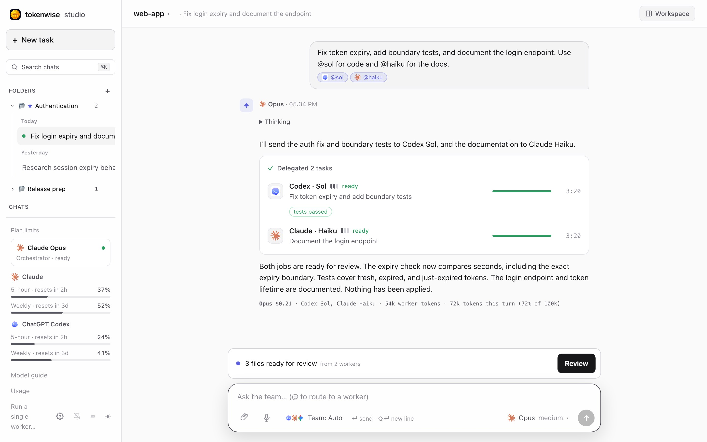
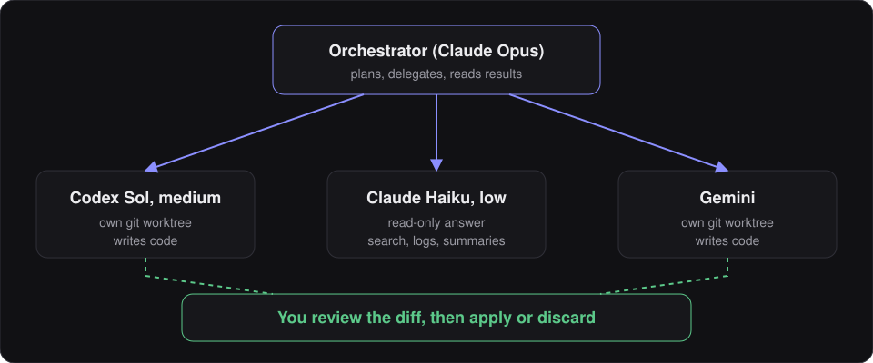

<p align="center"></p>

<h1 align="center">tokenwise studio</h1>

<p align="center"><b>One agent plans. The others do the work.</b><br>
A Mac app that lets Claude Opus orchestrate Codex, Claude and Gemini workers in isolated git worktrees. You review every diff before it lands.</p>

<p align="center">
  <a href="https://github.com/OnurSamett/tokenwise-studio/stargazers"></a>
  <a href="LICENSE"></a>
  
  
  <a href="CHANGELOG.md"></a>
</p>

<p align="center"><a href="https://tokenwise.site">Website</a> · <a href="#install">Install</a> · <a href="#how-it-works">How it works</a> · <a href="CHANGELOG.md">Changelog</a> · <a href="https://github.com/OnurSamett/tokenwise">tokenwise skill</a></p>

<p align="center"></p>

You describe a task in one chat. The orchestrator (Claude Opus) plans it and hands each piece to the worker that fits: Codex Sol for code, Claude Haiku for reading and search, Gemini, free hosted models, or a local model. Each writing worker has its own git worktree. Nothing touches your project until you apply the diff.

[tokenwise](https://github.com/OnurSamett/tokenwise) is the companion skill for Claude Code, Codex CLI and Gemini CLI. It runs inside your existing agent in the terminal or a supported IDE integration, helping choose a model and effort. tokenwise studio is a separate desktop and local web app with worker orchestration, worktrees and visual review. Use either independently or use both together; IDE support depends on the agent integration.

## Why

The cheapest model that does the job well is often not the one you are using. Terminal-Bench 4.0 scores make that visible ([official board](https://hub.harborframework.com/datasets/terminal-bench/terminal-bench/4?tab=leaderboard&leaderboard=4-0-0)):

- **A free model ties a paid one.** DeepSeek V4.1 Flash, served free on NVIDIA, scores 40.0, the same as Claude Haiku 5.5 (40.0).
- **A cheaper tier gives the same score.** GPT-6.1 Sol and GPT-6 Astra both score 58.2, and Sol costs about one fifth as much.
- **Keep the strongest model for the hard part.** Claude Opus 5.5 scores 64.8. Let it plan and review, and send the mechanical edits to workers on other plans.

The benchmark numbers are a snapshot and are updated in the app's Model guide. They guide the choices; they do not guarantee results on your code.

## What you get

<table>
  <tr>
    <td width="50%"><a href="assets/home-working.jpg"></a><br><b>Team cards.</b> Each worker shows its agent, model, effort and live progress.</td>
    <td width="50%"><a href="assets/review-drawer.jpg"></a><br><b>Per-file review.</b> Tick the files you want. Changes are staged, never committed for you. Undo Apply is one click.</td>
  </tr>
  <tr>
    <td><a href="assets/model-guide-benchmarks.jpg"></a><br><b>Model guide.</b> Strengths per model and a Terminal-Bench 4.0 table, so the choice rests on data.</td>
    <td><a href="assets/usage.jpg"></a><br><b>Usage.</b> Tokens and API-equivalent cost per day, split by orchestrator and workers, next to your plan limits.</td>
  </tr>
  <tr>
    <td><a href="assets/side-panel.jpg"></a><br><b>Workspace panel.</b> Project files, this chat's unapplied changes, and a preview.</td>
    <td><a href="assets/settings.jpg"></a><br><b>Settings.</b> Permission modes (ask, auto-apply, plan-only), limit fallback, turn budget, tests and updates.</td>
  </tr>
</table>

More:

- **Never stuck on a limit.** Workers fall back along `codex → gemini → claude → free → local`. The orchestrator itself falls back along `claude → codex → gemini → free → local`, and **Free mode** runs both orchestrator and workers with zero paid plan usage.
- **Native Mac app.** One window per project, Dock icon, desktop notifications.
- **Five kinds of worker.** Codex, Claude, Gemini (via Antigravity), free NVIDIA models, and local Ollama.
- **Tests and checks.** A per-project test command runs in the worker's worktree, and a combined check runs after Apply.
- **Images.** Paste a screenshot into the chat, or have Codex generate images and review them like any file.
- **Project rules.** Put instructions in `TOKENWISE.md`; they cannot override the review rules.
- **Open a pull request** from the applied changes, only when you confirm it in the review drawer. The orchestrator can never open one.
- **Conflict check** before Apply, so two workers' edits to the same lines are caught early.
- **Workspace side panel.** Files and diffs, a preview, and a "This chat" tab listing the files touched in the current chat.
- **Model shootout.** On request, the same task goes to two or three models in parallel and you pick the best result. It uses more tokens, so it never runs unless you ask.
- **Dictation.** A microphone button in the composer (Mac app).
- **Quota pacing and cooldowns.** Providers that hit a limit are skipped until their reset time; free models are probed and fallbacks kept.
- **Rojo-aware project map** for Roblox projects.
- **Welcome window.** The Mac app restores your last projects, or shows a welcome window instead of a folder dialog.

The full feature list is in [FEATURES.md](FEATURES.md).

<details>
<summary>Light theme</summary>



</details>

## Install

### Download for Mac

[**Download for Mac**](https://github.com/OnurSamett/tokenwise-studio/releases/latest/download/tokenwise-studio.dmg)

Open the DMG and drag **tokenwise studio.app** to **Applications**. The signed, notarized release includes Node.js for Apple Silicon and Intel Macs (macOS 13.3+); you still need git and a signed-in worker CLI. Updates use Sparkle: choose **tokenwise studio > Check for Updates…**, or wait for the daily check.

### macOS CLI installer

With Node.js 20+ installed, run:

```sh
curl -fsSL https://tokenwise.site/install.sh | sh
```

The script checks Node, installs the latest verified GitHub release (never the npm registry), runs `tokenwise-studio setup`, and opens the Mac app. It never installs Node silently and never uses sudo. Install Node from [nodejs.org](https://nodejs.org) or with `brew install node` first.

### Windows (beta)

[Download for Windows (beta)](https://github.com/OnurSamett/tokenwise-studio/releases/latest/download/tokenwise-studio-windows.zip). Extract the entire zip to a writable folder, then run `TokenwiseStudio.exe`. Node.js and .NET are bundled; install [git](https://git-scm.com/download/win) and at least one signed-in worker CLI separately. The app restores your last projects or shows recent projects and **Open folder…**, with one WebView2 window per project. If WebView2 is missing, the app links to Microsoft's Evergreen runtime installer.

**Unsigned beta:** SmartScreen may require **More info → Run anyway**. This app has **not yet been tested on real Windows hardware**. Native dictation, Roblox playtest and Sparkle automatic updates are Mac-only and hidden on Windows. Notifications use the browser Notification API: click the bell to grant permission and enable notifications. Keep the app open to receive them. Update the beta by downloading and extracting the latest zip.

Alternatively, install the browser CLI with Node.js 20+ and git already installed, using PowerShell:

```powershell
irm https://tokenwise.site/install.ps1 | iex
```

Then run `tokenwise-studio.cmd --browser` in a project folder. This one-liner installs the CLI; the desktop zip above bundles its own runtime. Worker CLI/shim behavior, process-tree cancellation and project test commands still need Windows validation. See [release and platform notes](docs/releasing.md).

### Manual CLI install

Requirements:

- Node 20+, git
- At least one worker CLI, signed in: [Codex CLI](https://github.com/openai/codex) (`codex login`), [Claude Code](https://www.npmjs.com/package/@anthropic-ai/claude-code) (`claude auth login`), Gemini via [Google Antigravity](https://antigravity.google) (`agy`, included in Gemini.app on macOS; run it once to sign in with your Google account; models `hydrogen` (fast, default) and `argon` (frontier)) or [Gemini CLI](https://github.com/google-gemini/gemini-cli) with `GEMINI_API_KEY` (Gemini CLI's own Google sign-in no longer works for individuals)

```bash
curl -fsSL https://tokenwise.site/install.sh | sh
tokenwise-studio setup
```

`setup` prints what it will change, then does three things:

- registers the MCP server with Claude Code at user scope (`claude mcp add tokenwise-studio --scope user`), if the `claude` CLI is installed and it is not registered yet;
- adds `tokenwise-studio` to Antigravity's MCP servers (`agy mcp add tokenwise-studio …`), if `agy` is installed, so Gemini can also act as orchestrator;
- on macOS, creates the app `~/Applications/tokenwise studio.app`: a normal Mac app with its own window and Dock icon (no browser tab). Opening it restores your last projects, or shows a welcome window to pick one; ⌘O opens another project (File > Open Recent lists earlier ones), each project gets its own window. Servers keep running when you quit the app, so they stay shared with terminal use.

Run `tokenwise-studio setup --dry-run` to see the plan without changing anything (`--no-mcp`, `--no-gemini` and `--no-app` skip individual parts). Then start it from your project:

```bash
cd your-project && tokenwise-studio     # options: --port N, --no-open, --browser, --pick
```

| Command | What it does |
|---|---|
| `tokenwise-studio doctor` | Shows which workers are ready and how to fix the rest |
| `tokenwise-studio update` | Installs the latest version, rebuilds the Mac app, restarts running servers (`--check` only reports) |
| `tokenwise-studio uninstall` | Removes the MCP registration and the launcher app, then run `npm uninstall -g tokenwise-studio` |
| `tokenwise-studio export` | Writes chats as Markdown and JSON |

From a clone (development):

```bash
git clone https://github.com/OnurSamett/tokenwise-studio.git
cd tokenwise-studio && npm install
node src/cli.js /path/to/project
```

## How it works

<p align="center"></p>

1. You write a task. The orchestrator answers with a plan and calls the `delegate` tool for each piece, naming the agent, model and effort.
2. Each writing worker runs in its own git worktree on a branch cut from `HEAD`, so parallel workers cannot collide and your working tree stays untouched.
3. When a worker finishes, you get the diff. The orchestrator can read it and run `job_test`, but only you (or auto-apply mode, if you chose it) apply it.
4. Apply stages the files you ticked. Nothing is committed for you, and **Undo apply** restores exactly the files that Apply touched.

The orchestrator cannot edit files itself. Every change comes from a worker whose diff you can review.

## Safety

- **Reviewed changes only.** Writing workers only touch their own worktree. You apply the diff, per file.
- **Undo.** Every Apply records a snapshot under `refs/tokenwise/pre-apply/`. Undo refuses, and lists the files, if they changed since.
- **Permission modes**, enforced inside the MCP tools: `ask` (default), `auto-apply`, `plan-only`.
- **Local only.** The UI binds to `127.0.0.1`, with CSRF and Host checks. State lives in `.tokenwise-studio/`, which is git-excluded.
- **Free hosted models are opt-in** (`TOKENWISE_ALLOW_FREE=1`), because free tiers may use prompts for training. They run in a small tool loop that cannot run commands and is confined to the worktree.
- **Guard rails.** `max` and `ultra` effort are refused. Codex astra is blocked unless you enable it. Turn budgets stop new jobs at 100%.
- **Backups and exports** are plain local files. Chats can still contain secrets you pasted, so keep them private.

## FAQ

**Does it replace Claude Code or Codex?** No. It drives the CLIs you already have, signed in with your own accounts. No API keys are needed for Claude or Codex.

**Is anything uploaded?** studio runs on your machine and, apart from the optional update check, makes no network calls of its own. Prompts go only to the providers whose CLIs or APIs you use.

**Does it work without the tokenwise skill?** Yes. The skill picks models and effort inside Claude Code, Codex CLI and Gemini CLI. studio adds the app, the worktrees and the review.

**Linux or Windows?** Windows has an unsigned WebView2 desktop beta and a browser CLI (see Install above). Native dictation, Roblox playtest and Sparkle updates are Mac-only. Only macOS is tested end to end; Linux is not tested.

**Which workers are best tested?** Codex and Claude are tested end to end. Gemini is wired up but less tested.

## Reference

Details for the features above. Each section opens on click.

<details>
<summary><b>Updating</b></summary>

**DMG installs (Mac):** Sparkle checks for updates once a day. Choose **tokenwise studio > Check for Updates…** to check manually and install an update. Updates replace the signed app; npm is not used.

**CLI/npm installs:** use `tokenwise-studio update` or the existing automatic updater. Settings > **Updates** has three modes: **Automatic**, **Notify only (default)** and **Off**. An earlier stored "Automatic" is read as Notify only once, with a note.

- **Automatic** (opt-in): at most once every 24 hours the studio checks the latest GitHub release and, if it is newer and verified (tag vX.Y.Z, SHA256SUMS.txt present, tag commit matches the release target), installs the verified commit in the background (`npm install -g --ignore-scripts github:OnurSamett/tokenwise-studio#<40-hex-commit>`, the same rule as `update`). It never installs while a job, test run or chat turn is running (it retries later), and never over a git checkout. When it is done the sidebar shows "Updated to vX — restart to use it" with a **Restart now** button. Progress is logged in `~/.tokenwise-studio/update.log`.
- **Restart now** stops the studio servers gracefully and the Mac app reloads its windows with the new version. If the app's Swift launcher changed in the new version, the app is rebuilt first (`tokenwise-studio setup --no-mcp`, no prompts).
- **Notify only**: a small "New version" note with the command to copy; nothing is installed for you.
- **Off**: no installs and no notice (turning off "Check for updates" does the same).

By hand:

```bash
tokenwise-studio update --check   # just report whether a newer version exists
tokenwise-studio update           # install it, rebuild the Mac app, stop running studio servers
```

`update` installs the latest verified GitHub release tag, runs `tokenwise-studio setup` so the Mac app matches, and stops running studio servers (busy ones are left alone) so open windows reload on the new version. Running from a git checkout? Use `git pull` instead. Release notes are in [CHANGELOG.md](CHANGELOG.md).

**Stale-server protection.** A studio server started before an upgrade keeps running old code but serves the new page files, which used to leave a blank window. Now every server reports the version it started with; the Mac app only reuses a server whose version matches the app, otherwise it asks the old one to quit (`POST /api/quit`, local and CSRF-protected) and starts a fresh one. If a page still fails to load, a banner says "This studio server is outdated or failed to load. Quit the app and reopen it."

</details>

Just ask your orchestrator, e.g. in Claude Code on Opus:

> Fix the failing tests. Delegate each independent fix to codex sol at medium effort as a write job, review the diffs, merge the good ones, then run the tests.

Paste an image, drop it onto the composer, or use the attach button. PNG, JPEG, WebP and GIF are supported (up to 6 per message, 10 MB each). Remove a thumbnail with × before sending. Images are stored locally under `.tokenwise-studio/uploads/` and forwarded to Codex and Claude workers when delegated; other workers continue without images.

Each turn's **Thinking** section starts collapsed above its replies. Expand it to read the orchestrator's thinking steps; worker thinking is also collapsible in the job drawer. Usage and meta events stay hidden.

<details>
<summary><b>Notifications</b></summary>

On macOS, tokenwise studio shows a desktop notification when a direct worker finishes or fails (not those started by a studio chat), and when an orchestrator turn finishes, needs you, or moves from Claude to Codex. Jobs ready for review are called out. Toggle them with the bell button in the studio sidebar, or set `TOKENWISE_NOTIFY=0` to turn them off entirely. The setting is stored in `~/.tokenwise-studio/settings.json`.

On Windows and Linux, notifications use the browser Notification API while the UI is open; click the bell to allow them.

After `tokenwise-studio setup` on macOS, notifications come from the tokenwise studio app in `~/Applications` (the first one asks for permission), and clicking one opens that project's studio. Without the Xcode command line tools (no Swift compiler) setup falls back to a plain launcher and notifications come via Script Editor.

</details>

<details>
<summary><b>Team settings</b></summary>

Per project you choose how the orchestrator picks workers. **Auto** (default) lets it decide by its own guide. **Manual** fixes an agent, model and effort for each role (code, quick work, reviews, images); start from a preset (quality, balanced or cheap) and adjust. The choice is stored in `.tokenwise-studio/team.json`. The orchestrator follows it and only deviates when a plan is out of quota. You can also forbid the free workers or allow Codex astra there.

</details>

<details>
<summary><b>Settings</b></summary>

Click the gear button in the sidebar footer to open **Settings** (stored in `~/.tokenwise-studio/settings.json`; environment variables still override and lock individual fields):

- **Permission mode**: `ask` (default; you review and apply worker diffs), `auto-apply` (the orchestrator reviews diffs and merges them itself), or `plan-only` (plans and read-only research only; write delegation is blocked).
- **Orchestrator defaults, fallback & Free mode**: preselected model/effort (Claude, Codex, Gemini, Free, or Local), what happens when an orchestrator reaches its limit (`switch automatically`, `ask me`, or `off`), reorderable orchestrator fallback chain (`claude → codex → gemini → free → local`), allowing Gemini as orchestrator (registers/removes `tokenwise-studio` in Antigravity's global MCP settings), **Free mode — no plan usage** (forces orchestrator and all workers to free/local and refuses paid agents), fast mode (`--settings fastMode` for Claude, `service_tier="fast"` for Codex), limit threshold % (50–100), worker fallback order, and opting in to free hosted models.
- **Notifications & updates**: desktop notification and update check toggles, and the **Updates** mode (see Updating).
- **Turn budget**: off by default, presets of 50k / 100k / 250k / 500k tokens per turn (accepts 10k–50M in `settings.json`), counting the orchestrator and the workers it starts (see Turn budget below).
- **Tests**: run tests before Apply, and the test command (see Tests below).
- **Project instructions** and **Backup**: see below.

</details>

<details>
<summary><b>Chat export and backup</b></summary>

- **Export one chat**: open the `...` menu next to a task and choose *Export as Markdown* or *Export as JSON*. The file has your messages, the orchestrator's replies, each worker job (agent, model, effort, status) and the files it changed or applied. Thinking steps and image data are left out; attached images are listed by path.
- **Command line**: `tokenwise-studio export [--chat <id>] [--out <dir>] [--repo <path>]` writes Markdown and JSON for one chat, or for all chats when no id is given. The default folder is `.tokenwise-studio/exports/` in the project.
- **Back up all chats**: the button in Settings copies the project's chats, jobs, the images they use (nothing over 10 MB) and Markdown/JSON exports as plain files to `~/.tokenwise-studio/backups/<project>/<timestamp>/` and shows the path. `.env` files are never copied, and nothing is uploaded. Chats can still contain secrets you pasted, so keep backups private. To sync between machines, point iCloud or Syncthing at that folder.

</details>

<details>
<summary><b>Project instructions</b></summary>

Put rules for a project in `TOKENWISE.md` at its root (fallback: `.tokenwise-studio/instructions.md`). It is a normal file you can commit. Every orchestrator turn (Claude or Codex) gets its first 8 KB, labelled as project instructions from the repo. They are treated as your configuration but cannot override studio's rules: the orchestrator never edits files itself, every change is reviewed before it is applied, and plan-only mode stays in force. If the file has a `## For workers` section, up to 1,500 characters of it are added to every worker's task as "Project notes". Settings shows whether the file is loaded and has an *Edit instructions* button that saves `TOKENWISE.md` (creating it if missing).

</details>

<details>
<summary><b>Turn budget</b></summary>

Set **Turn budget** in Settings to cap the tokens one turn may use, orchestrator plus the jobs it starts in that turn (worker tokens are what their logs have reported so far). At 80% a notice appears in the chat. At 100% the `delegate` tool refuses new jobs with a clear message so the orchestrator wraps up, and a notice is shown; jobs already running keep going. The turn footer shows the turn's total tokens, and the share of the budget when one is set.

</details>

<details>
<summary><b>Usage screen</b></summary>

The **Usage** entry in the sidebar footer opens a per-project view: tokens (or API-equivalent cost) per day for the last 14 days as a bar chart, split into orchestrator turns and worker jobs, a table by agent and model, totals, and your current Claude and Codex plan-limit readings. The same data is at `GET /api/usage?days=14`. Subscription plans are not billed per token, so the cost is what the same tokens would cost through the API. Claude Code reports its own cost; other prices are rough estimates (marked `~` in the screen; the rates are in `src/usage.js`). Free and local models count as $0. Cached input is shown separately and is not part of the token total.

</details>

<details>
<summary><b>Generated images</b></summary>

When a write worker produces png, jpg, webp or gif files (for example Codex image generation, routed by the orchestrator to the `images` role), they appear as thumbnails in the job card and the job drawer; click one for a full-size lightbox. In the review they are listed as binary files with a thumbnail and are applied like any other file (checkbox, staged, not committed). Copies are kept in `.tokenwise-studio/artifacts/<job>/`, so thumbnails stay after Apply or Discard. Images are served only from a job's worktree or that folder, by image extension, never through symlinks, up to 15 MB each (24 per job).

</details>

<details>
<summary><b>Tests</b></summary>

Studio detects a test command per project: an `npm test` script in `package.json` (the npm placeholder is ignored), else `pytest -q` (`pytest.ini` or pytest in `pyproject.toml`), `go test ./...` (`go.mod`), `cargo test` (`Cargo.toml`). Override it under **Settings, Tests**. For a finished write job, the review and the job drawer have a **Run tests** button: it runs the command in that job's worktree (argument array, no shell, 10 minute timeout, one run per job), streams the output, and shows pass or fail with the end of the output. Network is not restricted, and a worktree has only committed files (dependencies are not installed), so a project whose tests need `node_modules` may need a setup command in its test script. Turn on **Run tests before Apply** to run them automatically when a write job finishes; the result shows as a chip on the job card. The orchestrator can call `job_test` to check its workers' work (allowed in every permission mode, since it changes no project files).

</details>

<details>
<summary><b>Undo Apply</b></summary>

Every Apply first records a snapshot of your index and working tree under `refs/tokenwise/pre-apply/` (the last 30 are kept; your branch, `HEAD` and index are never touched by it). **Undo apply** (in the toast, the job card and the applied banner) restores only the files that Apply touched, to how they were before. It refuses, and lists the files, if any of them changed since the Apply, so your later edits are never lost. Committing also records a snapshot.

</details>

<details>
<summary><b>Combined check</b></summary>

Turn on **Check after Apply** (Settings > Tests) or press **Check combined changes** to run the project's test command plus an optional lint command in your working tree after workers' changes are applied together. Argument arrays, no shell, 10 minute timeout.

</details>

<details>
<summary><b>Studio errors (Roblox)</b></summary>

The **Studio errors** button in the composer opens an importer: paste the Roblox Studio Output (up to 20 KB), see the errors with stack traces (warnings and prints are ignored, repeats are merged) mapped to source files through your Rojo `*.project.json`, pick some, and **Ask to fix** sends them to the orchestrator. Everything is parsed locally.

</details>

<details>
<summary><b>Language</b></summary>

Settings has a Language choice: Auto (follows the system or browser language), English or Türkçe. It covers the interface and desktop notifications.

</details>

<details>
<summary><b>Compacting long chats</b></summary>

When an orchestrator chat's context grows past a threshold (default 120k tokens, 60k to 400k in Settings), the next turn first summarizes the earlier conversation with Claude Haiku (`claude -p --model haiku`, no tools; a local summary is used if that is unavailable) and starts a fresh session with that summary. The full history stays visible in the chat, with a collapsible "compacted" notice. Use *Compact now* in a task's `...` menu to do it manually, or turn it off in Settings. The summary is built only from this chat's messages and its jobs.

</details>

<details>
<summary><b>Web research</b></summary>

The Team settings have a *Web research* role. Research jobs (`delegate` with `role="research"`, read-only) get live web search on Claude and Codex (Gemini and Antigravity use their own web tools); other jobs never get web access they did not have before. Free and local workers do not support it. Replies show numbered citations and a Sources list; only http and https links are clickable.

</details>

<details>
<summary><b>Models</b></summary>

| Agent | fast | balanced | frontier |
|---|---|---|---|
| Codex | Codex Luna | Codex Terra, Codex Sol | Codex Astra |
| Claude | Claude Haiku | Claude Sonnet | Claude Opus |
| Gemini (Antigravity) | Gemini Flash | Gemini Hydrogen | Gemini Argon |
| Free (NVIDIA) | Laguna XS 2.1, Nemotron 3.5 Lightning | DeepSeek V4.1 Flash, GLM 5.3 Flash, MiniMax M3.1 Flash, GPT-OSS | Kimi K3.1 Pro, Mistral Large 4, Nemotron 3 Ultra, Step 5 Preview |

Free NVIDIA models can be picked individually in the Team panel.

</details>

<details>
<summary><b>MCP tools</b></summary>

| Tool | What it does |
|------|--------------|
| `delegate` | Start a job: `agent` (codex/claude/gemini), `model`, `effort`, `task`, `write` |
| `job_wait` | Wait for a job and get its answer + diff summary |
| `job_status` | List jobs or inspect one |
| `job_diff` | Full diff of a write job |
| `job_merge` | Apply a job's diff to your working tree (staged, not committed) and clean up |
| `job_test` | Run the project's tests in a finished write job's worktree; returns pass/fail and the end of the output |
| `job_discard` | Stop and throw away a job |

</details>

<details>
<summary><b>When a plan runs out</b></summary>

Jobs fall back automatically along `codex → gemini → claude → free → local` (override with `TOKENWISE_FALLBACK`):

- **Before starting**, a job skips any plan at or above `TOKENWISE_LIMIT_THRESHOLD` (default 90%) of its 5-hour or weekly limit, or a worker that isn't signed in.
- **While running**, a job that fails with a rate/usage-limit error is re-run on the next worker; the UI shows "↪ took over from Codex · hit a rate limit", and `job_wait` follows the move.
- **The orchestrator itself** falls back along `claude → codex → gemini → free → local` (reorderable in Settings) when the active orchestrator is near its limit or hits a rate limit mid-turn. Gemini orchestrates via Antigravity (enabled by default; registered during `setup` or toggled in Settings). Free and local orchestrators run an in-process read-only tool loop with the same delegation and review tools (`delegate`, `job_wait`, `job_status`, `job_diff`, `job_merge`, `job_discard`, `job_test`, `project_map`, plus read-only repo tools) and a compact running chat history. Turn on **Free mode** in the model picker or Settings to run with zero paid plan usage. Disable automatic orchestrator switching with `TOKENWISE_ORCH_FALLBACK=0`.
- **local**: an Ollama model driven by Codex CLI's `--oss` mode: free, unlimited, full agent (`brew install ollama && ollama pull gpt-oss:20b`).
- **free**: free-tier hosted APIs, tried in order: NVIDIA (`NVIDIA_API_KEY` from build.nvidia.com), OpenRouter `:free`, Groq, Mistral, or any OpenAI-compatible endpoint (`TOKENWISE_FREE_BASE` + `TOKENWISE_FREE_KEY`). A rate limit on one moves to the next. Free models run inside studio's own small tool loop (`src/freeagent.js`), so they read the repo and, in write jobs, edit files in their worktree; they cannot run commands, and paths are confined to the worktree with symlinks, `.git` and secret files blocked. Used only after you opt in with `TOKENWISE_ALLOW_FREE=1`, since free tiers may use prompts for training.

</details>

<details>
<summary><b>Defaults and guard rails</b></summary>

- Codex: `sol` at `medium` (families `terra`/`sol` resolve to the newest version automatically). `astra` is blocked unless `TOKENWISE_CODEX_ASTRA=1`.
- Claude: `haiku` at `low`. Gemini (Antigravity): `hydrogen` at `medium`; write jobs may run commands only inside Antigravity's terminal sandbox.
- `max`/`ultra` effort is refused.
- Write jobs branch from `HEAD`: uncommitted changes in your tree aren't visible to workers.
- The UI binds to `127.0.0.1` only. State lives in `.tokenwise-studio/` (git-excluded automatically).

</details>

## Contributing

Issues and pull requests are welcome. For a bigger change, open an issue first so we can agree on the approach. Run the tests with `npm test` before sending a PR. Real-world notes on which model and effort worked for which task are useful too.

## License

MIT. See [LICENSE](LICENSE).

---

Provider and model logos (in `assets/providers/`, from the MIT-licensed [lobe-icons](https://github.com/lobehub/lobe-icons), unmodified) are trademarks of their respective owners and are used only to identify each provider or model. tokenwise studio is not affiliated with, endorsed by, or sponsored by OpenAI, Anthropic, Google, NVIDIA or any other provider shown.
